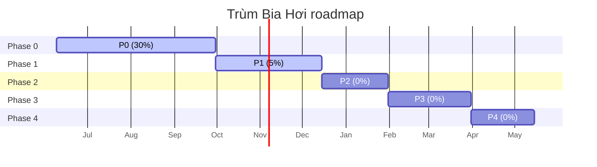

# Trùm Bia Hơi — Progress Dashboard

> **Auto-generated** từ [`implementation-tracker.md`](implementation-tracker.md) bằng `tools/dashboard-engine/build_dashboard.py`.
> KHÔNG edit trực tiếp — sửa tracker rồi rebuild.
> **Cập nhật:** 2026-09-08 10:56 · **Branch hiện tại:** `master`

Để xem dashboard HTML đẹp hơn: mở [`dashboard.html`](dashboard.html) bằng browser.

---

## Tổng quan

- **MVP progress:** **22%** (2/26 PR merged)
- **In flight:** 6 PR · **Blocked:** 0 · **Deferred:** 0
- **Target (estimate, baseline 06-ROADMAP v2.7):** Phase 0 xong ~T9/2026 (chặn bởi Alpha playtest) · Phase 1/MVP ~15/12/2026

## Phase progress

| Phase | Merged / Total | % | Progress |
|-------|:--------------:|:-:|:---------|
| Phase 0 | 2 / 7 | 30% | `███░░░░░░░` |
| Phase 1 | 0 / 5 | 5% | `░░░░░░░░░░` |
| Phase 2 | 0 / 2 | 0% | `░░░░░░░░░░` |
| Phase 3 | 0 / 9 | 0% | `░░░░░░░░░░` |
| Phase 4 | 0 / 3 | 0% | `░░░░░░░░░░` |

## Phase breakdown — features & tasks

### Phase 0 — 2/7 · 30% `███░░░░░░░`

| PR | Feature | Status | Computed | Branch |
|----|---------|:------:|:--------:|--------|
| `F04` | Vòng Đời Cốc — bottleneck cốc clean→in_use→dirty→washing→clean | ✅ Merged | BACKLOG ✓ normal | `prototype/` |
| `F01` | Vòng Lặp Mở Ca — ca 12 phút, thể lực, trần ngày 500k | 🟡 In progress | BACKLOG ✓ normal | `prototype/` |
| `F02` | Menu & Kinh Tế Quán — 3 món P0 (bia+2 mồi), đo k | 🟡 In progress | IN_PROGRESS ✓ normal | `prototype/` |
| `F03` | Hệ Bàn — 3 bàn, serve theo Order | 🟡 In progress | BACKLOG ✓ normal | `prototype/` |
| `F05` | Độ Hơi Bia — mất hơi 12s, cờ vàng, MVP mềm | ✅ Merged | BACKLOG ✓ normal | `prototype/` |
| `F06` | Tip / Uy tín / Phạt — VIP ×10, grace window | 🟡 In progress | BACKLOG ✓ normal | `prototype/` |
| `F08` | Giờ Vàng — 2 mức (nhẹ 90s/nặng 150s), spawn floor | 🟡 In progress | IN_PROGRESS ✓ normal | `prototype/` |

### Phase 1 — 0/5 · 5% `░░░░░░░░░░`

| PR | Feature | Status | Computed | Branch |
|----|---------|:------:|:--------:|--------|
| `F24` | Thiết Kế UI/UX Quán Bia — tokens, wireframe, sprite, animation | ⬜ Not started | — | `—` |
| `F07` | Các Kiểu Khách — 3 loại P1 (thường/vội/VIP) | 🟡 In progress | ABANDONED ✓ normal | `prototype/` |
| `F09` | Thời Tiết Quán — tối giản (hệ số độ hơi/tip/spawn) | ⬜ Not started | — | `—` |
| `F10` | Nâng Cấp Quán — bom/rửa/hầm/bàn cơ bản (×k) | ⬜ Not started | — | `—` |
| `F25` | Ngôn Ngữ / Tài Khoản — chọn vi/en, guest play, Google login | ⬜ Not started | — | `—` |

### Phase 2 — 0/2 · 0% `░░░░░░░░░░`

| PR | Feature | Status | Computed | Branch |
|----|---------|:------:|:--------:|--------|
| `F11` | Bếp & Mồi Nóng — bếp 2 cấp, 3 mồi nóng | ⬜ Not started | — | `—` |
| `F17` | Nhiệm Vụ Quán Nhậu — 7 nhánh (ngày/ca/gift/điểm danh/referral/ĐLT) | ⬜ Not started | — | `—` |

### Phase 3 — 0/9 · 0% `░░░░░░░░░░`

| PR | Feature | Status | Computed | Branch |
|----|---------|:------:|:--------:|--------|
| `F23` | Kiến Trúc Server Quán — server-auth, websocket, CAPTCHA | ⬜ Not started | — | `—` |
| `F12` | Giải Nhậu & Vụ Bia — 8 bậc, 2 Vụ Bia song song | ⬜ Not started | — | `—` |
| `F13` | Đường Lên Trùm — LP0–LP7, gate tính năng & mặt bằng | ⬜ Not started | — | `—` |
| `F14` | Mặt Bằng Quán — 9 mặt bằng, rent/cọc 7 ngày | ⬜ Not started | — | `—` |
| `F15` | Sự Cố Quán Nhậu — bảo kê, kiểm tra ATTP, trộm offline | ⬜ Not started | — | `—` |
| `F16` | Rủ Bạn & Huy Hiệu — 3 mốc, huy hiệu Kết Nối | ⬜ Not started | — | `—` |
| `F18` | Chó Giữ Quán — combat bảo kê, bảo hiểm trộm | ⬜ Not started | — | `—` |
| `F22` | Bia Đấm — LLM server-side, quota 20/ngày | ⬜ Not started | — | `—` |
| `F26` | Vé Mở Ca & Thanh Toán — free 1 ca/ngày, paid unlock daily cap | ⬜ Not started | — | `—` |

### Phase 4 — 0/3 · 0% `░░░░░░░░░░`

| PR | Feature | Status | Computed | Branch |
|----|---------|:------:|:--------:|--------|
| `F19` | Cúp Bóng Đá — lịch + tỉ số thật, TV, Giờ Vàng xem bóng | ⬜ Not started | — | `—` |
| `F20` | Mời Bia Hơi — cosmetic-only, KHÔNG P2W | ⬜ Not started | — | `—` |
| `F21` | Vé Số Lấy Hên — xổ số/Vietlott, **cần legal review** | ⬜ Not started | — | `—` |

## Timeline

## Đang làm

### F01 — Vòng Lặp Mở Ca — ca 12 phút, thể lực, trần ngày 500k

- **Status:** 🟡 In progress
- **Branch:** `prototype/`
- **Wave:** 🎮 Code
- **Gates:** 🔒S
- **Phase:** Phase 0
- **Notes:** ca 12' + trần ngày 500k xong; thể lực persist deferred → Phase 1 (`stamina-day-budget`).

### F02 — Menu & Kinh Tế Quán — 3 món P0 (bia+2 mồi), đo k

- **Status:** 🟡 In progress
- **Branch:** `prototype/`
- **Wave:** ⚖️ Economy
- **Gates:** 🔒S 🔒B
- **Phase:** Phase 0
- **Notes:** 3/6 món. **5-seed sim k=2.24–2.34** (2026-07-15, mỗi seed ≥503 lượt) — PASS dải 2.0–3.0; **tái lập độc lập 2026-08-24**, khớp từng số. Chờ hand-play xác nhận.

### F03 — Hệ Bàn — 3 bàn, serve theo Order

- **Status:** 🟡 In progress
- **Branch:** `prototype/`
- **Wave:** 🎮 Code
- **Gates:** 🔒S
- **Phase:** Phase 0
- **Notes:** 3 bàn + serve-theo-Order + queue; chưa 4 cấp/mua-nâng cấp.

### F06 — Tip / Uy tín / Phạt — VIP ×10, grace window

- **Status:** 🟡 In progress
- **Branch:** `prototype/`
- **Wave:** 🎮 Code
- **Gates:** 🔒S
- **Phase:** Phase 0
- **Notes:** Có tip; chưa uy tín/phạt cụm.

### F08 — Giờ Vàng — 2 mức (nhẹ 90s/nặng 150s), spawn floor

- **Status:** 🟡 In progress
- **Branch:** `prototype/`
- **Wave:** 🎮 Code
- **Gates:** 🔒S 🔒P
- **Phase:** Phase 0
- **Notes:** P0: toggle normal/peak xong; P1/P2 (lịch/full) chưa.

### F07 — Các Kiểu Khách — 3 loại P1 (thường/vội/VIP)

- **Status:** 🟡 In progress
- **Branch:** `prototype/`
- **Wave:** 🎮 Code
- **Gates:** 🔒S 🔒B
- **Phase:** Phase 1
- **Notes:** 3/6 loại (thường/vội/VIP) đã code ở mức lõi Phase 0; đủ ở P2.

## Up next

| PR | Feature | Phase | Status |
|----|---------|-------|--------|
| `F24` | Thiết Kế UI/UX Quán Bia — tokens, wireframe, sprite, animation | Phase 1 | ⬜ Not started |
| `F09` | Thời Tiết Quán — tối giản (hệ số độ hơi/tip/spawn) | Phase 1 | ⬜ Not started |
| `F10` | Nâng Cấp Quán — bom/rửa/hầm/bàn cơ bản (×k) | Phase 1 | ⬜ Not started |
| `F25` | Ngôn Ngữ / Tài Khoản — chọn vi/en, guest play, Google login | Phase 1 | ⬜ Not started |
| `F11` | Bếp & Mồi Nóng — bếp 2 cấp, 3 mồi nóng | Phase 2 | ⬜ Not started |

---

**Rebuild:** chạy `python3 tools/dashboard-engine/build_dashboard.py` sau mỗi lần đổi status trong [`implementation-tracker.md`](implementation-tracker.md).
